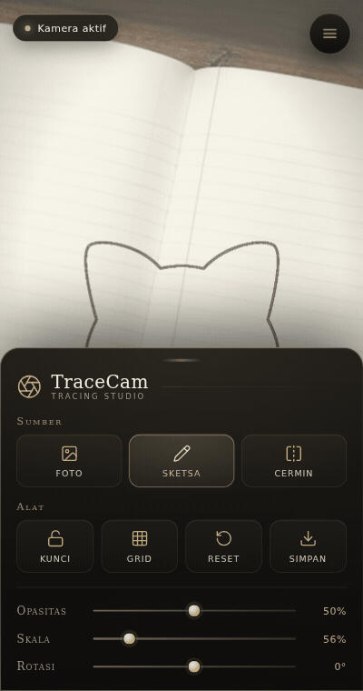

# TraceCam

**Jiplak gambar apa saja dengan kamera HP.** Arahkan kamera ke kertas, atur
gambar referensi di layar, lalu jiplak. Gratis, offline, dan tanpa install.

<p align="center">
  
</p>

## Fitur

- **Langsung dari browser** — tidak perlu unduh atau memasang aplikasi.
- **Bisa offline** — setelah dibuka sekali, aplikasi tersimpan di perangkat
  (PWA).
- **Kamera penuh layar** — tampilan kamera belakang untuk menjiplak di kertas.
- **Mode sketsa** — gambar diubah menjadi garis secara otomatis.
- **Gestur alami** — geser satu jari, cubit untuk zoom, putar dengan dua jari.
- **Panel klasik** — atur opasitas, skala, rotasi, grid, dan kunci posisi.
- **Simpan hasil** — simpan tampilan kamera beserta jiplakan sebagai PNG.

## Mulai

Butuh [Deno](https://deno.com) 2.x.

```bash
deno task dev
```

Buka `http://localhost:8080`. Untuk menjalankan tanpa watch:

```bash
deno task start
```

## Cara pakai

1. Buka TraceCam, lalu izinkan akses kamera.
2. Tekan **Foto** dan pilih gambar yang ingin dijiplak.
3. Geser dengan satu jari; cubit dan putar dengan dua jari.
4. Aktifkan **Sketsa** untuk mengubah gambar menjadi garis.
5. Atur **Opasitas** agar gambar terlihat tipis di atas kertas.
6. Tekan **Kunci** supaya gambar tidak bergeser saat mulai menjiplak.
7. Tekan **Simpan** untuk menyimpan hasilnya sebagai PNG.

## Catatan kamera

Browser hanya mengizinkan kamera pada **secure context**:

- `http://localhost` di perangkat yang sama, atau
- alamat **https://**, misalnya lewat Cloudflare Tunnel atau ngrok.

Alamat IP LAN biasa seperti `http://192.168.x.x` tidak bisa membuka kamera.
Kalau izin pernah ditolak, buka pengaturan situs di browser, ubah izin kamera
menjadi **Allow**, lalu muat ulang halaman.

## Struktur

```text
.
├── server.ts               # Entry point: menjalankan Deno.serve
├── deno.json               # Task, import map, dan konfigurasi format
├── src/
│   ├── app.ts              # Rakit Hono: middleware, API, static, fallback
│   ├── middleware/logger.ts
│   └── routes/api.ts
├── public/                 # Semua aset yang dikirim ke browser
│   ├── index.html          # Markup + sprite ikon SVG
│   ├── css/style.css       # Tema klasik (kuningan, serif, bottom sheet)
│   ├── js/                 # Modul ES: kamera, gesture, overlay, sketsa, dll.
│   ├── manifest.json       # Metadata PWA
│   ├── sw.js               # Service worker untuk mode offline
│   └── icon.svg
└── docs/demo.gif           # GIF demo untuk README
```

Tidak ada build step. Semua modul di `public/js/` dimuat langsung oleh browser.

## API

| Method | Path          | Keterangan             |
| ------ | ------------- | ---------------------- |
| GET    | `/api/health` | Cek status server      |
| POST   | `/api/traces` | Contoh endpoint (echo) |

Path `/api/*` yang tidak dikenal mengembalikan `404` dalam format JSON.

## Perintah

| Perintah          | Fungsi                       |
| ----------------- | ---------------------------- |
| `deno task dev`   | Jalankan server dengan watch |
| `deno task start` | Jalankan server tanpa watch  |
| `deno task check` | Type-check TypeScript        |
| `deno task fmt`   | Format kode                  |
| `deno task lint`  | Lint kode                    |

Port bisa diubah lewat environment variable `PORT`:

```bash
PORT=3000 deno task dev
```

## Teknologi

Deno · Hono · TypeScript · Vanilla JS (ES modules) · Canvas API · PWA

## Deploy

Deploy `server.ts` ke [Deno Deploy](https://deno.com/deploy). Untuk platform
lain, ganti `serveStatic` dari `@hono/hono/deno` dengan adapter static yang
sesuai.
